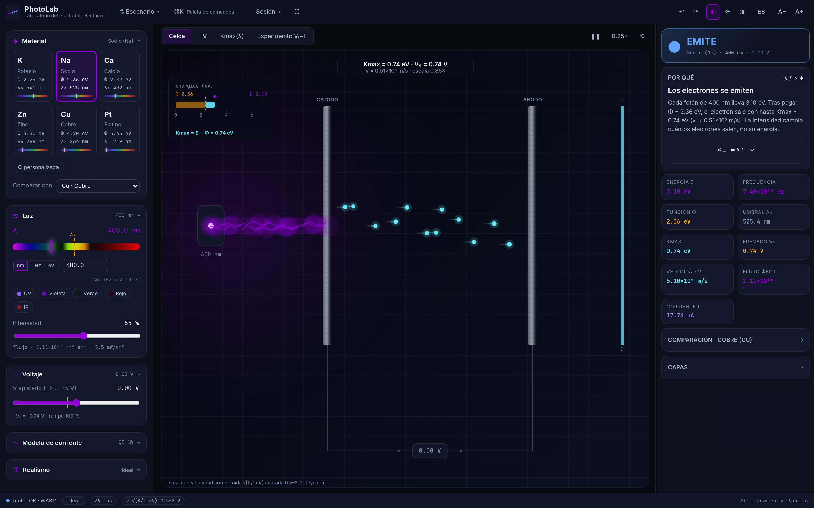

# PhotoLab · laboratorio del efecto fotoeléctrico

Migración de [`Software-Casero-Proyect`](https://github.com/omarPVP123131/Software-Casero-Proyect)
(egui + Macroquad) a **Tauri 2**: un solo toolkit de UI (Svelte 5 + canvas 2D) y
la física original en Rust (`fotoelectrico-physics`) reutilizada **sin
cambios**, expuesta por comandos `invoke` y por WASM.

| | |
|---|---|
| Escritorio | Tauri 2 (`src-tauri`) · Windows / macOS / Linux |
| Frontend | Svelte 5 + Vite + TypeScript (`frontend`) |
| Física | `fotoelectrico-physics` (40+ tests) → `photolab-model` (contrato + ajuste) |
| Tipos | `ts-rs` genera 17 bindings TS desde los structs de Rust |
| Tests | Rust (56) · Vitest (5) · Playwright E2E + snapshot de canvas (6) |



## Descarga para Windows

- **[PhotoLab portable (.exe)](https://github.com/omarPVP123131/Software-Casero-Proyect/releases/latest)** — un solo archivo, se ejecuta sin instalador.
- Requisitos: Windows 10/11. No hace falta Rust, Node ni .NET. WebView2 viene incluido en Windows 11 y en Windows 10 actualizado; si faltara en un equipo antiguo, se instala una vez desde Microsoft.
- La versión anterior (egui + Macroquad) queda disponible en la rama [`legacy-egui`](https://github.com/omarPVP123131/Software-Casero-Proyect/tree/legacy-egui).

---

## Qué cambia respecto al proyecto original

| Riesgo del proyecto original | Cómo se resuelve aquí |
|---|---|
| **Doble toolkit** egui + Macroquad (dos bucles de eventos, DPI, ventana compartida) | Se eliminan ambos. Una sola ventana Tauri con un WebView; canvas y paneles comparten el mismo árbol DOM. |
| Animación dependiente de frames | Todo el movimiento se integra con **`dt` real acotado** (`Scene.svelte`, máx. 50 ms) → misma física a 30, 60 o 144 Hz; incluye pausa y cámara lenta 0.25×. |
| Escala de velocidad √(Kmax) que aplasta Na vs Pt | Escala `√(Kmax/1 eV)` acotada **0.5–2.2** con **leyenda permanente** ("escala comprimida") y modo **log real** (v = 10⁵ m/s → 0.5×, 10⁷ m/s → 2.2×) seleccionable en Realismo. |
| Accesibilidad | Paleta apta para daltonismo, el estado se codifica con **color + icono + forma + texto**, `--font-scale` global, tema claro/oscuro/alto contraste, `prefers-reduced-motion`. |
| Gráficas pobres | Ejes con unidades siempre visibles, lectura bajo el cursor, zoom/pan, restablecer vista y export **PNG/SVG** (más CSV/PDF). |
| Explicaciones escasas | Frase causal generada desde el motor + **modo guiado** con pregunta de predicción obligatoria antes de revelar. |
| No se guardaba la sesión | Sesión completa en `.photolab.json` (material, controles, puntos del experimento, notas, preferencias) + autoguardado. |
| `calculate_effect` 61×/frame | La curva Kmax(λ) se calcula **solo al cambiar el material**; las evaluaciones continuas van por WASM, coalescidas por frame. |
| Sin tests visuales | Snapshot de la escena (`Scene.svelte`) con Playwright contra el build estático: cualquier regresión de píxeles rompe CI. |

---

## Estructura

```
photolab/
├── crates/
│   ├── physics/         fotoelectrico-physics, copiado tal cual (única fuente de verdad)
│   ├── model/           Session/Readout/FitReport, escenarios, ajuste V₀–f, CSV, ts-rs
│   ├── tauri_commands/  comandos invoke puros (física + archivos)
│   └── wasm/            los mismos comandos vía wasm-bindgen (motor del canvas)
├── frontend/            Svelte 5 + Vite + TS (UI completa)
├── src-tauri/           cáscara Tauri 2, plugins, autoguardado, actualizador
├── scripts/             gen-types.sh · build-wasm.sh · screenshots.mjs · make_icons.mjs
├── docs/design-spec.md  sistema de diseño "laboratorio óptico moderno"
└── assets/              capturas del README
```

## Motor: un solo camino

```
controles Svelte → store `lab` (TS tipado)
   ├─ WASM  photolab_wasm::evaluate()  ← slider en vivo (sin IPC)
   └─ Tauri invoke physics_evaluate    ← respaldo / escritorio sin WASM
                    ↓
              photolab-model  →  fotoelectrico-physics
```

No hay IPC por frame. `invoke` se usa para disco (guardar/abrir sesión,
exportar, autoguardado) y como respaldo del motor; la física interactiva corre
en WASM dentro del mismo hilo del canvas.

## Comandos

```
physics_evaluate(controlsJson, prefsJson) → EvaluateResponse
physics_material_catalog()                → MaterialInfo[]
experiment_fit(pointsJson)                → FitReport | null
experiment_sweep(requestJson)             → SweepPoint[]
experiment_csv(experimentJson)            → string
session_normalize(sessionJson)            → Session
save_session / load_session / export_file (cáscara Tauri: + diálogos)
open_report_html(html, filename)          → ruta  (escribe <config>/reports y lo abre)
```

## Cómo se arranca

```bash
# requisitos: Node 20+, Rust stable, y en Linux las libs de Tauri
# libgtk-3-dev libwebkit2gtk-4.1-dev libsoup-3.0-dev librsvg2-dev

cd frontend && npm install          # .npmrc ya fija legacy-peer-deps
npm run build:wasm                  # wasm-pack → frontend/src/lib/wasm
npm run gen:types                   # ts-rs → frontend/src/lib/generated

npm run dev                         # navegador en :1420
npm run tauri dev                   # ventana de escritorio
```

Empaquetado: `npm run tauri build` → instaladores en
`src-tauri/target/release/bundle/` (`.msi`/`.exe`, `.dmg`, `.deb`/`.AppImage`).
El actualizador (`tauri-plugin-updater`) queda sin endpoint hasta que se
configure `plugins.updater` con la clave de firma.

### Informes PDF en escritorio

`window.open` no funciona dentro del WebView de Tauri, así que el cuaderno y el
informe V₀–f **no** usan ventanas emergentes: el frontend construye un HTML
autocontenido y llama a `open_report_html`, que lo escribe en
`<config>/reports/` y lo abre con la aplicación del sistema (navegador), donde
el diálogo de impresión genera el PDF. En navegador sí se usa la ventana
emergente y, si está bloqueada, se descarga el HTML (`lib/io.ts → openReport`).

## Tests

```bash
cargo test --workspace          # 56 ✓ (física, modelo, ajuste, comandos)
cargo clippy --workspace -- -D warnings   # limpio
cd frontend
npm run test                    # vitest 5/5 (puente WASM + store)
npm run test:e2e                # Playwright 6/6 contra `vite preview` (build estático)
npx svelte-check --tsconfig ./tsconfig.json   # 0 errores, 3 avisos benignos
```

**Verificado en Linux (WebKitGTK 2.54), incluida la app de escritorio:** el
binario release se compila, arranca bajo Xvfb y pinta la escena completa contra
el backend Tauri (`motor OK · Tauri IPC` en la barra de estado, captura en
`assets/app-tauri-linux.png`).

```bash
# instaladores generados por `tauri build`
target/release/bundle/deb/PhotoLab_2.0.0_amd64.deb          # 5.0 MiB
target/release/bundle/rpm/PhotoLab-2.0.0-1.x86_64.rpm       # 5.0 MiB
target/release/bundle/appimage/PhotoLab_2.0.0_amd64.AppImage # 106 MiB
```

> En máquinas con poca RAM conviene `cargo build --jobs 1` y tener swap; sin él
> la compilación de `webkit2gtk` puede morir por OOM.

El E2E (7) cubre: canvas pintado, **snapshot visual de la escena** (sodio
400 nm), cambio a rojo sin emisión → bloqueo por frenado, paleta de comandos +
escenario "Medir h" con ajuste, tutorial con pregunta de predicción, informe
V₀–f generado como HTML autocontenido y tema de alto contraste.

## Flujo de trabajo con la física

`crates/physics` **no se toca**. Cualquier cambio de contrato se hace en
`crates/model`: los structs llevan `#[derive(TS)]` + `#[ts(export)]` y el
`serde(rename_all = "camelCase")` debe coincidir con el nombre que infiere
ts-rs (por eso los campos con sufijo de unidad llevan `#[serde(rename)]`
explícito: `slopeVs`, `hExperimentalJs`, …). Los tests del crate regeneran
`frontend/src/lib/generated` vía `PHOTOLAB_TS_OUT`.

## Accesibilidad

- Estado de emisión: color **y** icono **y** palabra (⟳ nunca solo color).
- Todo control es alcanzable por teclado; foco visible; `aria-label` en iconos.
- Lecturas anunciadas con `aria-live` (estado + explicación causal).
- `prefers-reduced-motion` desactiva estelas/bloom y arranca en pausa.
- Tema de alto contraste sin blur ni sombras; escala de fuente 0.85–1.4.

## Licencia

MIT (ver `LICENSE`). La física proviene del proyecto original del mismo autor.

## Windows

La app es Tauri 2: en Windows usa **WebView2** (motor de Edge). Requisitos,
comandos exactos y lista de comprobación en [`WINDOWS.md`](WINDOWS.md).

Compilar y empaquetar (MSI + NSIS):

```powershell
cargo install wasm-pack
rustup target add wasm32-unknown-unknown
cd frontend; npm ci; npm run build:wasm; cd ..
frontend\node_modules\.bin\tauri build
```

> **Importante:** la feature `custom-protocol` (en `src-tauri/Cargo.toml`)
> es la que incrusta la interfaz en el ejecutable. Con `cargo build --release`
> a secas el binario busca `http://localhost:1420` y abre en blanco; usa
> siempre `tauri build`.

`.github/workflows/windows.yml` hace esto mismo en `windows-latest` y deja
el MSI y el instalador NSIS como artefacto.
